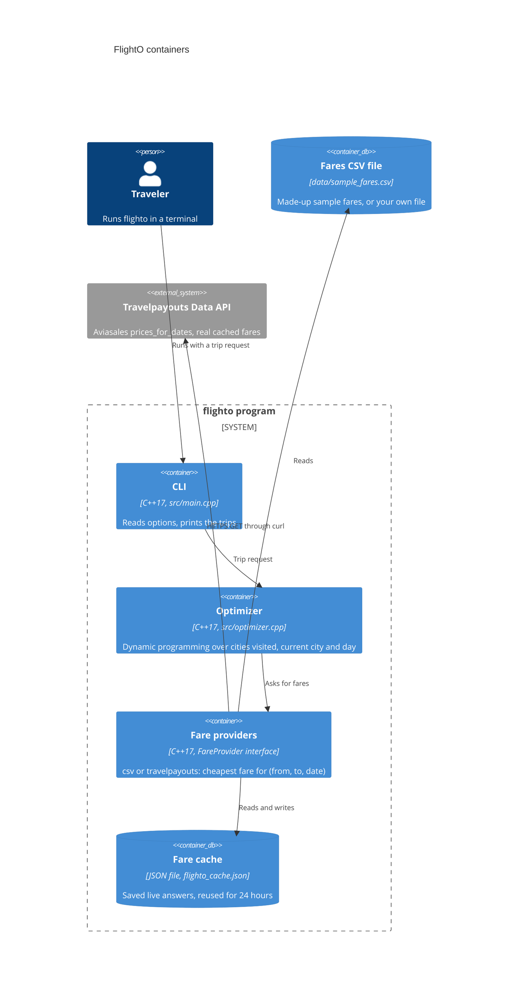

# FlightO

FlightO finds the cheapest set of flights for a trip through several cities. You give it your home airport, the cities you want to visit with how many nights to stay in each, and a date window, and it picks the order and the flight dates that cost the least.

It is a small C++17 command line program built with CMake.

## Quick start

You need a C++17 compiler (it is tested with GCC 16 from MinGW-w64 on Windows 11), CMake 3.16 or newer, and `curl` for live prices (Windows 10 and later include it).

```sh
cmake -S . -B build -DCMAKE_BUILD_TYPE=Release
cmake --build build
cd build && ctest --output-on-failure && cd ..
```

Then run the demo from the repository root. It uses the sample fares in `data/sample_fares.csv`, so it needs no API key. The prices in that file are made up (see [About the prices](#about-the-prices)).

```sh
./build/flighto --from YUL --visit CDG:3-5 --visit BCN:2-4 --visit FCO:3-4 --depart 2027-05-01 --return-by 2027-05-20 --fares data/sample_fares.csv
```

On Windows the program is `build\flighto.exe`. With a multi-config generator such as Visual Studio it is `build\Release\flighto.exe`.

## Usage

```
flighto --from CODE --visit CODE:MIN-MAX [--visit ...] --depart DATE --return-by DATE [options]
```

| Option | Meaning |
|---|---|
| `--from CODE` | Home airport (3-letter IATA code). The trip starts here. |
| `--visit CODE:MIN-MAX` | A city to visit and how many nights to stay. Repeat it, or give a list like `CDG:3-5,BCN:2-4`. `CDG:4` means exactly 4 nights. Cities can be visited in any order. |
| `--depart DATE` | Earliest departure date, `YYYY-MM-DD`. |
| `--return-by DATE` | Latest date for the flight home. With `--no-return`, the date the last stay must end by. |
| `--no-return` | End the trip in the last city instead of flying home. |
| `--provider NAME` | Where fares come from: `csv` (default) or `travelpayouts`. |
| `--fares FILE` | Fares file for the `csv` provider. Default `data/sample_fares.csv`. |
| `--currency CODE` | Currency of the prices. Default `USD`. |
| `--alternatives N` | How many runner-up trips to show. Default 2, at most 9. |
| `--cache FILE` | Where live fares are saved between runs. Default `flighto_cache.json`. An empty value turns it off. |
| `--cache-hours H` | How long a saved live fare is reused. Default 24. |
| `--max-requests N` | Most live API requests in one run. Default 600. |

Exit status: `0` a trip was found, `1` bad input or a provider error, `2` no trip fits the dates and fares.

### Example 1: a round trip through three cities (sample fares)

```sh
./build/flighto --from YUL --visit CDG:3-5 --visit BCN:2-4 --visit FCO:3-4 --depart 2027-05-01 --return-by 2027-05-20 --fares data/sample_fares.csv
```

Real output from that command (the prices are the made-up sample fares):

```
FlightO: cheapest trip from YUL
  Visit:   CDG 3-5 nights, BCN 2-4 nights, FCO 3-4 nights (any order)
  Window:  2027-05-01 to 2027-05-20, back in YUL by the end
  Fares:   csv file data/sample_fares.csv (567 fares), prices in USD

Best trip: 1112.00 USD
  Tue 2027-05-11  YUL -> FCO     496.00  then 3 nights in FCO
  Fri 2027-05-14  FCO -> BCN      98.00  then 2 nights in BCN
  Sun 2027-05-16  BCN -> CDG     104.00  then 3 nights in CDG
  Wed 2027-05-19  CDG -> YUL     414.00  home
  Order: YUL > FCO > BCN > CDG > YUL

Alternative 1: 1118.00 USD (+6.00)
  Tue 2027-05-04  YUL -> FCO     495.00  then 3 nights in FCO
  Fri 2027-05-07  FCO -> BCN      99.00  then 2 nights in BCN
  Sun 2027-05-09  BCN -> CDG     105.00  then 3 nights in CDG
  Wed 2027-05-12  CDG -> YUL     419.00  home
  Order: YUL > FCO > BCN > CDG > YUL

Alternative 2: 1135.00 USD (+23.00)
  Wed 2027-05-05  YUL -> BCN     533.00  then 4 nights in BCN
  Sun 2027-05-09  BCN -> FCO      80.00  then 4 nights in FCO
  Thu 2027-05-13  FCO -> CDG      97.00  then 5 nights in CDG
  Tue 2027-05-18  CDG -> YUL     425.00  home
  Order: YUL > BCN > FCO > CDG > YUL

Fares looked up: 159 distinct (from, to, date), 24 with no flight
Search: 131 of 480 states reached in 0.1 ms
```

### Example 2: a one-way trip that ends in the last city

```sh
./build/flighto --from YUL --visit CDG:3-5,LIS:2-3 --depart 2027-05-01 --return-by 2027-05-12 --no-return --alternatives 1
```

The best answer on the sample fares is YUL to LIS on 2027-05-04, then LIS to CDG on 2027-05-06, for 491.00 USD.

### Example 3: real prices from Travelpayouts

```sh
export TRAVELPAYOUTS_TOKEN=your_token_here     # PowerShell: $env:TRAVELPAYOUTS_TOKEN = "your_token_here"
./build/flighto --provider travelpayouts --from YUL --visit CDG:3-5,BCN:2-4 --depart 2027-05-01 --return-by 2027-05-20
```

The first run asks the API for each fare it needs and saves the answers in `flighto_cache.json`. Running it again within 24 hours reuses them.

## How it works

FlightO asks its fare provider one question at a time: "what is the cheapest one-way flight from A to B on this day?" A missing answer means there is no flight that day.

The search walks forward through the days of the window. For each combination of "cities already visited", "city I am in now" and "day I landed there", it remembers the cheapest way to get there. From each of those it tries every allowed stay length and every city not visited yet, and keeps the cheaper result for the next combination. When every city has been visited, it adds the flight home. Every flight moves forward in time, so by the time the search reaches a day it already knows every way of getting there. That makes the answer exact for the fares it was given: it is the same answer you would get by trying every order, start date and stay length.

This is the Held-Karp dynamic programming method for the traveling salesman problem, with an extra day axis and the stay windows as constraints. A few details:

- **Alternatives.** Each combination keeps its 3 cheapest partial trips instead of 1 (1 + `--alternatives`), so the runner-up trips come out of the same search.
- **Pruning.** A partial trip that can no longer fit the minimum stays of the cities left before `--return-by` is dropped, and the fares it would need are never fetched.
- **Memoized fares.** Each (from, to, date) is asked of the provider at most once per run. Live answers are also saved on disk.

Cost, with `n` cities, `W` days in the window, `R` the widest stay range (max - min + 1) and `K` = 1 + alternatives:

| | Size |
|---|---|
| Search states | `2^n * n * (W + 1)` |
| Time | `O(2^n * n^2 * W * R * K)` |
| Memory | `O(2^n * n * W * K)`, 16 bytes each |
| Fare lookups | at most `(n + 1) * n * (W + 1)`, usually far fewer |

For 8 cities, a 90-day window and stays of 2 to 5 nights, the search takes about 20 ms and uses about 9 MB (this is one of the tests). With live fares, almost all of the time goes into fetching fares, not into the search. Trying every order instead would mean 8! = 40,320 orders times every start date and stay length. The program accepts up to 10 cities and a 366-day window.



### What it assumes

- A flight's date is the day it leaves. Nights are counted between flight dates, so overnight flights are not modeled.
- Fares are one-way. A round-trip or multi-city ticket can be cheaper than the sum of one-way fares, and FlightO does not search for those.
- Each city is visited exactly once, and you stay at least 1 night in each.

## Fare providers

Both providers implement the same small interface (`src/fare_provider.h`), so adding another source means writing one class with one lookup method.

| Provider | How to use it | Environment variable | Data |
|---|---|---|---|
| `csv` | `--provider csv --fares FILE` | none | Fares from a CSV file. The default file holds made-up sample prices. |
| `travelpayouts` | `--provider travelpayouts` | `TRAVELPAYOUTS_TOKEN` | Real prices from the Travelpayouts (Aviasales) Data API. |

### csv

One one-way fare per line. Lines starting with `#` are comments, and the header line is optional:

```
from,to,date,price
YUL,CDG,2027-05-01,512.00
CDG,YUL,2027-05-09,560
```

A (from, to, date) that is not in the file means there is no flight that day. If a flight appears twice, the cheaper price is used.

### travelpayouts

- **Token.** Create a free Travelpayouts account; the token is under Profile, API token. Put it in the `TRAVELPAYOUTS_TOKEN` environment variable. FlightO only reads it from there. Never commit it.
- **Endpoint.** `GET https://api.travelpayouts.com/aviasales/v3/prices_for_dates` with `origin`, `destination`, `departure_at=YYYY-MM-DD`, `one_way=true` and `currency`. The token is sent in the `X-Access-Token` header, not in the URL. Requests go through the system `curl`, so the header is visible in the machine's process list while a request runs.
- **What the prices are.** Real fares that Aviasales users found in the last 48 hours, served from Aviasales' cache. A route and day that nobody searched recently comes back empty and is treated as "no flight", so a live search can miss trips. These are not booking quotes; check the price with the airline before you buy.
- **Quota.** The documented limit for this method is 600 requests per minute. FlightO stops after `--max-requests` requests in a run (default 600) and says so, and it saves every answer, including "no flight", in `flighto_cache.json` (ignored by git) for `--cache-hours` hours. A run that stops early can be continued by running it again.
- **Why this provider.** It gives real prices on a free token and has an endpoint for exactly the question the optimizer asks: the cheapest fare for an origin, a destination and a date.

## About the prices

- `data/sample_fares.csv` is a SAMPLE dataset. Its prices are made up for demos and tests and are not real fares. They come from a simple formula: a base price per route, cheaper midweek days, some noise, and some days with no flight.
- Live prices come only from the provider you pick (`--provider travelpayouts`). FlightO does not invent or adjust them.

## Project layout

```
src/            optimizer, fare providers, dates, CLI
tests/          unit tests (doctest) and their fixtures
data/           sample_fares.csv (made-up SAMPLE prices)
third_party/    nlohmann/json and doctest single headers, with their MIT licenses
```

`tests/fixtures/travelpayouts_prices_for_dates.json` is a saved sample shaped like the response example in the Travelpayouts docs, not a real API answer.

## History

The 2022 version of this repository was a Quebec City bus route planner, built as a university course project. It loaded the RTC's GTFS transit data and searched routes with an improved Dijkstra algorithm. Flights were the goal from the start, but there was no free flight data to work with then. That version is kept at the tag `v0-transit` (`git checkout v0-transit`).

## License

No license has been chosen for FlightO yet. The libraries in `third_party/` are MIT licensed; their license files are next to them.
